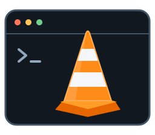

<p align="center">
  
</p>
<h1 align="center">VLC-TTY</h1>
<p align="center">Your media. Your terminal. Even over SSH.</p>
<p align="center">
  <a href="https://github.com/chinmaykrishnroy/VLC-TTY/actions/workflows/ci.yml"></a>
  <a href="LICENSE"></a>
  
  
</p>

**VLC-TTY plays video inside your terminal**, with familiar VLC controls powered by LibVLC. Browse files, manage playback and watch through terminal graphics — including silent playback on a headless server over SSH.

> Development preview. A compatible terminal and an installed LibVLC 3 runtime are required. Raspberry Pi performance and terminal compatibility are being validated; see [validation](VALIDATION.md).

## Features

- Local files, folders and network URLs through LibVLC.
- Play/pause, seek, stop, speed control and frame stepping.
- File browser and independent playback queue with repeat modes.
- External SRT/VTT captions, track selection and subtitle timing controls.
- Kitty, Sixel and iTerm2 pixel graphics, plus ANSI half-block fallback.
- Silent SSH profile with bounded decode size and frame rate.
- Runtime diagnostics and a headless decoding check.

## Get started

Application archives are built for **Linux, Windows and macOS**, on **x64 and ARM64**. Download a matching archive from [Releases](https://github.com/chinmaykrishnroy/VLC-TTY/releases) when available, extract it, and put the executable in your PATH. These archives contain the application; install the media runtime separately.

| OS | Runtime setup |
| --- | --- |
| Ubuntu / Debian | `sudo apt-get install --no-install-recommends libvlc5 vlc-plugin-base` |
| Windows | Install matching-architecture VLC 3.x from [VideoLAN](https://www.videolan.org/vlc/); set `VLC_HOME` if it is outside the usual location. |
| macOS | Install matching-architecture VLC 3.x in `/Applications/VLC.app`, or set `VLC_HOME` to your app bundle. |

```sh
vlc-tty /path/to/movie.mp4
vlc-tty --subtitle movie.en.srt movie.mkv
vlc-tty --graphics ansi movie.mp4
vlc-tty --help
```

To build from source, install Rust stable and run `cargo build --locked --release`. The executable is `target/release/vlc-tty` (`vlc-tty.exe` on Windows). See [BUILDING.md](BUILDING.md).

## Watch over SSH

On the server, install the runtime and matching Linux executable. Then launch from your local terminal:

```sh
ssh -t user@pi 'vlc-tty --ssh --silent /path/to/movie.mp4'
```

No display or desktop session is required on the server. SSH sessions default to silent playback, 15 FPS and a 720p callback height cap. Your **local terminal** determines image-protocol support. Try `--graphics ansi` for broad compatibility or `--fps 10 --decode-height 480` on slower connections.

```sh
vlc-tty --ssh --doctor
vlc-tty --ssh --smoke-test /path/to/movie.mp4
```

The smoke check requires decoded frames and an advancing playback clock, without opening a UI. Sound is not forwarded to SSH client speakers. Read the [SSH guide](docs/SSH.md) for terminal setup, tmux and Pi acceptance checks.

## Controls

| Key | Action |
| --- | --- |
| `Space` / `s` | Play or pause / stop |
| `←` / `→` | Seek backward / forward 10 seconds |
| `f` / `Esc` | Fullscreen layout / return |
| `+` / `-` / `m` | Volume / mute (local or server audio) |
| `[` / `]` / `=` | Slower / faster / normal speed |
| `e` | Next frame |
| `n` / `p` / `Tab` | Next / previous / queue |
| `o` / `l` | Open media / load external captions |
| `Shift+S` / `Shift+A` | Subtitle / audio track picker |
| `,` / `.` | Adjust subtitle delay |
| `g` | Toggle pixel graphics / ANSI fallback |
| `?` / `i` / `q` | Help / media information / quit |

Mouse controls and menus are available where terminal mouse reporting is supported. Fullscreen changes the application layout. Use the terminal's own controls for OS-window fullscreen.

## Documentation

[SSH guide](docs/SSH.md) · [Building](BUILDING.md) · [Architecture](ARCHITECTURE.md) · [Objective](OBJECTIVE.md) · [Roadmap](ROADMAP.md) · [Releasing](RELEASING.md) · [Validation](VALIDATION.md) · [Changelog](CHANGELOG.md)

## Contributing

Bug reports are welcome. Include OS/architecture, terminal/version, `vlc-tty --doctor` output, media codec/resolution and steps to reproduce. For SSH issues, include whether tmux is involved. Keep private media URLs and credentials out of reports.

Before submitting changes, run formatting, unit tests and strict Clippy as described in [BUILDING.md](BUILDING.md). Playback changes also require the LibVLC runtime tests.

## License

Application code is [MIT licensed](LICENSE). LibVLC and its plugins have their own licenses. VLC-TTY is an independent project and is not affiliated with VideoLAN. The terminal-cone SVG is original project artwork inspired by the familiar media-player traffic cone.
